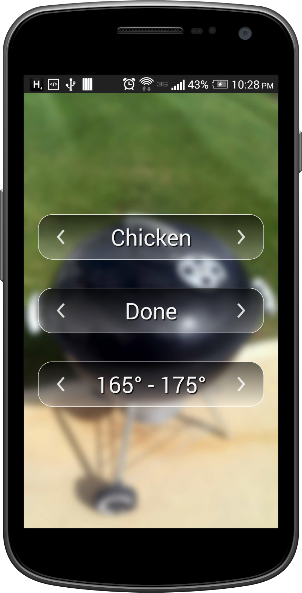

Grill Buddy is a simple Android application that tells you when your grilled meat is done.  Simply pick the meat, and how done you like it, and the app will tell you the temperature to cook it to.  Alternatively, pick the meat and temperature and the app will tell you how done that meat is at that point.



## Building

To build the app, run:

```
./gradlew assembleDebug
```

This will generate a debug APK in `app/build/outputs/apk/debug/`.
